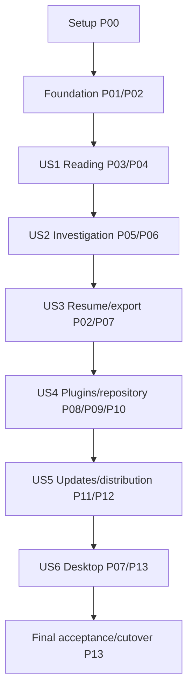

# Tasks: Full Tailviewer Migration

**Input**: [spec.md](spec.md), [plan.md](plan.md), [research.md](research.md), [data-model.md](data-model.md), [contracts](contracts/migration.md), [feature inventory](feature-inventory.md), [dependency inventory](dependency-inventory.md), [validation guide](quickstart.md).

**Created**: 2026-11-19 | **Git branch**: `master` | **Status**: Implementation started; T001-T003 complete, remaining tasks pending.

**Tests**: Explicitly requested. Write/port meaningful failing behavior cases before their implementation; a missing type/compiler error is not the expected failure. Reuse existing fixtures. Run targeted suites per task and broader suites when shared contracts change.

## Format and path conventions

Each item follows `- [ ] Tnnn [P?] [USn?] description` with concrete repository-relative paths and explicit prerequisite IDs. `[P]` means independent test-file authoring after its prerequisite gate; it does not permit shared project-file mutation or simultaneous builds in shared output directories. New filenames are proposed destinations: reuse an existing equivalent when found. Quoted data constraints are normative.

P00-P13 refer to plan milestones, while phases group work by user story. Shared P02 profile/identity substrate is foundational; US3 completes import UI/full persistence. US2 supplies parser/merge for US4. US4 verifies extension adapters independently; US6 supplies visible panel journeys. Base source/menu UI precedes plugin-only commands, so no cross-story cycle is needed.

## Delivery rules

One small buildable behavior/project slice with callers and tests per Conventional Commit; split any task further if review grows large and explain progress in Burmese. Do not batch a whole story into one commit. Use copied/synthetic fixtures, isolated temp profiles, loopback services and owned processes. Store raw result/commit/hardware/hash evidence under ignored `artifacts/migration/` and tracked evidence summaries in the inventory. No real user profile/database, published release or public deployment is mutated by tests. The generated constitution is unratified, not extra policy. Task generation does not implement these tasks.

## Phase 1: Setup — baseline and inventory (P00)

**Goal**: Existing behavior နဲ့ test baseline သိမ်းမည်။

**Independent Test / checkpoint**: Modern test results and isolated legacy build attempt recorded; every shipping command/setting/extension maps to fixture evidence.

### Implementation / verification

- [X] T001 Run current modern build/Avalonia/API/Core suites and an isolated legacy build attempt using `specs/001-full-project-migration/quickstart.md`; record commit/environment/failures/skips in `artifacts/migration/baseline.md`, never label unavailable legacy tooling as passing. **Depends**: none.
- [X] T002 Expand `specs/001-full-project-migration/feature-inventory.md` to exact menu/shortcut/CLI/settings/extension options and baseline tests; reconcile every project/reference with `specs/001-full-project-migration/dependency-inventory.md`. **Depends**: T001.
- [X] T003 Reuse/add deterministic log/profile/plugin/repository fixture definitions, expected values/order and hashes in `src/Tailviewer.Core.Tests/Migration/Fixtures/manifest.json`; generate large logs, do not commit huge binaries or real tokens. **Depends**: T002.
- [ ] T004 Map every legacy host/Archiver/Serilog/repository/acceptance/system fixture and shared helper to a modern owner in `specs/001-full-project-migration/feature-inventory.md`; record replacements for WpfUnit cases without dropping behavior. **Depends**: T003.
- [ ] T005 Capture actual transitive/native/framework usage and advisory timestamp per target in `artifacts/migration/dependencies.md`; inspect code before removing EF/SQLite/protobuf/PE or other declared packages. **Depends**: T004.

## Phase 2: Foundational — project edges and profile substrate (P01/P02)

**Goal**: UI-neutral metadata/settings နဲ့ stable identity ကို ပြင်ဆင်မည်။

**Independent Test / checkpoint**: Modern metadata/profile tests pass; original profile hashes unchanged; copied-store probe selects retain-or-convert path. All foundation tasks precede story work.

### Tests / contract checks

- [ ] T006 Port encoded-icon/metadata round-trip and WPF boundary tests into `src/Tailviewer.Archiver.Tests/Migration/MetadataTest.cs`; modern shared metadata exposes no WPF/Metrolib types. **Depends**: T005.

### Implementation / verification

- [ ] T007 Replace WPF metadata/icon types in `src/Tailviewer.Archiver/Plugins/Description/IPluginDescription.cs`, `src/Tailviewer.Archiver/Plugins/Description/PluginDescription.cs`, `src/Tailviewer.Archiver/Plugins/PluginGroup.cs` and packer callers with bytes/plain values; condition legacy adapters until their callers migrate. **Depends**: T006.
- [ ] T008 Convert `src/Tailviewer.Archiver/Tailviewer.Archiver.csproj` and `src/Tailviewer.Archiver.Tests/Tailviewer.Archiver.Tests.csproj` to SDK modern targets, isolate legacy-only loader/RPC implementations until US4, port shared helpers and add projects to `Tailviewer.Avalonia.slnx`; prove build plus metadata smoke. **Depends**: T007.
- [ ] T009 Use a disposable net10 probe in `artifacts/migration/storage-probe/` to open/export/reopen copied IsabelDb records; record ID/count/package/icon hashes and retain-or-neutral-export/SQLite fallback in `specs/001-full-project-migration/research.md` before storage implementation. **Depends**: T008.

### Tests / contract checks

- [ ] T010 Add defaults/unknown-node/malformed/read-only/interrupted-save tests in `src/Tailviewer.Core.Tests/Migration/ProfilePersistenceTest.cs`; enforce "Isolated migrated profile. Validate known values/defaults; preserve unknown data. Do not overwrite older original." Model constraint: "Isolated migrated profile. Validate known values/defaults; preserve unknown data. Do not overwrite older original. Existing defaults are baseline, not guessed.". **Depends**: T009.

### Implementation / verification

- [ ] T011 Port existing `src/Tailviewer/Settings/` UI-independent XML models/helpers into `src/Tailviewer.Core/Settings/Migration/`, preserving serialized names/defaults, plugin raw data and proxy/DPAPI CurrentUser encrypted password/salt (retain raw data and request re-entry if unavailable, never log plaintext); remove WPF color/Metrolib serializers at the boundary with primitive-value round-trip fixtures and UI conversion adapters; update callers/tests without introducing duplicate models. **Depends**: T010.
- [ ] T012 Implement separate modern path, bounded XML read, temporary validated save and same-volume atomic replacement in `src/Tailviewer.Core/Settings/Migration/ProfileStore.cs`; keep last valid profile on failure. **Depends**: T011.

### Tests / contract checks

- [ ] T013 Add original/backup hash, repeated import/conflict/cancel/duplicate identity tests in `src/Tailviewer.Core.Tests/Migration/ProfileImportTest.cs`; enforce "Copy and validate backup before saving destination" and "On conflict require keep/replace choice, retain current valid target if cancelled." Model constraint: "Copy and validate backup before saving destination. On conflict require keep/replace choice, retain current valid target if cancelled. No backup success claim before existence/hash checks.". **Depends**: T012.

### Implementation / verification

- [ ] T014 Implement backup-verified legacy conversion and keep/replace conflict handling in `src/Tailviewer.Core/Settings/Migration/LegacyProfileImporter.cs`; retain original/unknown nodes and save only validated destination. **Depends**: T013.

### Tests / contract checks

- [ ] T015 Add source/group/revision tests in `src/Tailviewer.Core.Tests/Migration/SourceIdentityTest.cs`; enforce "Groups reference IDs, not display names", "No cycles or duplicate member identities" and "stale async reads must not publish into newer generation." **Depends**: T014.

### Implementation / verification

- [ ] T016 Reuse existing source IDs/config in `src/Tailviewer.Core/Settings/Migration/SourceConfiguration.cs`; preserve missing-source configuration, source generation and deterministic group membership rather than parallel entry models. Model constraint: "Reopening same configured source preserves identity. Paths can be missing; never silently remove unavailable sources.". **Depends**: T015.
- [ ] T017 Run affected metadata/profile/identity suites, inspect net10 assets and record `artifacts/migration/foundation.md`; preserve working modern pins and keep legacy advisory/reference strictly outside modern outputs. **Depends**: T016.

## Phase 3: US1 — Read and navigate logs (P1; P03/P04)

**Goal**: Files/folders/groups၊ selection/navigation နဲ့ file recovery ပြည့်စုံစေမည်။

**Independent Test / checkpoint**: Open via picker/drop/argument/handoff; copy original text; preserve follow/pause and source identity; no stale rows after rotation. This is the MVP, not full migration.

### Tests / contract checks

- [ ] T018 [P] [US1] Add file/folder/group/open/close/switch/missing-state tests in `src/Tailviewer.Avalonia.Tests/SourcesTest.cs`, including cycles/duplicates and persisted IDs. **Depends**: T017.
- [ ] T019 [P] [US1] Add go-to-line/quick-navigation/character-and-line selection tests in `src/Tailviewer.Avalonia.Tests/NavigationTest.cs`; expected copy preserves original text/source order. **Depends**: T017.
- [ ] T020 [P] [US1] Extend `src/Tailviewer.Core.Tests/Sources/Text/Streaming/StreamingTextLogSourceTest.cs` with middle-only same-size rewrite/indistinguishable metadata, truncate/regrow and changed-encoding fixtures; assert final contents and stale-result rejection. **Depends**: T017.
- [ ] T021 [P] [US1] Add native picker/drop/clipboard/single-instance scenarios in `src/Tailviewer.Acceptance.Tests/Migration/SourceEntryPointTest.cs`; own test processes/temp paths, keep current tooling until project port. **Depends**: T017.

### Implementation / verification

- [ ] T022 [US1] Port file/folder operations from `src/Tailviewer/BusinessLogic/DataSources/` into `src/Tailviewer.Core/Sources/Migration/` and bind loading/empty/error tree items in `src/Tailviewer.Avalonia/Views/SourcesView.cs`. **Depends**: T018.
- [ ] T023 [US1] Implement stable ordered groups, include/exclude, rename, close-current/all in `src/Tailviewer.Avalonia/ViewModels/SourcesViewModel.cs`; missing paths remain unresolved, not deleted. Model constraint: "No cycles or duplicate member identities; deterministic timestamp-tie and missing-timestamp rules pinned to baseline fixtures.". **Depends**: T022.
- [ ] T024 [US1] Wire multi-file/folder picker, drag/drop and arguments in `src/Tailviewer.Avalonia/MainWindow.cs` and `Program.cs`; cancel preserves current workspace. **Depends**: T023, T021.
- [ ] T025 [US1] Port single-instance handoff to `src/Tailviewer.Avalonia/SingleApplicationHelper.cs` using mutex/named pipes with bounded validated messages and owned-process cleanup. **Depends**: T024.
- [ ] T026 [US1] Bind source identity/revision in `src/Tailviewer.Avalonia/LogDocument.cs`, cancel/dispose old reads on switch/close and reject late generations while preserving bounded batch/cache behavior. Model constraint: "Retain original position/provenance through filters/merges. Revision invalidates cached rows and derived results after replacement; stale async reads must not publish into newer generation.". **Depends**: T025.
- [ ] T027 [US1] Fix `src/Tailviewer.Core/Sources/Text/Streaming/StreamingTextLogSource.cs` replacement/truncate/middle-rewrite convergence against SC-003/006; measure cost and surface impossible detection guarantees as spec issues, never silently skip them. **Depends**: T020, T026.
- [ ] T028 [US1] Add persisted encoding selector/reopen in `src/Tailviewer.Avalonia/Views/EncodingView.cs` and `LogDocument.cs`; preserve BOM/default/invalid-byte semantics and invalidate decoder/cache on accepted change. **Depends**: T027.
- [ ] T029 [US1] Implement source-aware go-to-line/quick navigation in `src/Tailviewer.Avalonia/Views/NavigationView.cs`; handle unavailable/out-of-range targets clearly. **Depends**: T019, T028.
- [ ] T030 [US1] Restore legacy text/line selection, keyboard and original-order copy in `src/Tailviewer.Avalonia/Views/LogSelection.cs`; keep virtualized controls unless measured behavior forces narrow custom rendering. **Depends**: T029.
- [ ] T031 [US1] Integrate per-source follow/pause with scrolling/selection/navigation/rotation in `src/Tailviewer.Avalonia/MainWindow.cs`; never force follow after user pause. **Depends**: T030.
- [ ] T032 [US1] Run US1 targeted suites/native entry-point checks; record `artifacts/migration/US1.md` and F01-F04/F10 evidence in `specs/001-full-project-migration/feature-inventory.md`. **Depends**: T031.

## Phase 4: US2 — Search, filter and correlate (P1; P05/P06)

**Goal**: Search/filter/highlight၊ parser/columns နဲ့ merge ကို ပြန်ချိတ်မည်။

**Independent Test / checkpoint**: Known matches, composed rules, parsed fields, deterministic timestamp ties/missing values and original provenance match baseline while logs change; no plugin service required.

### Tests / contract checks

- [ ] T033 [P] [US2] Port search/next/previous/find-all/options/cancel/live-append fixtures into `src/Tailviewer.Core.Tests/Migration/SearchMigrationTest.cs`; results use source position/revision. Model constraint: "Reject invalid rules without crashing; ordering/composition from baseline. Search result references source position/revision. Large operations cancellable.". **Depends**: T032.
- [ ] T034 [P] [US2] Port text/level/time/expression include/exclude fixtures into `src/Tailviewer.Core.Tests/Migration/FilterMigrationTest.cs`; enforce "Reject invalid rules without crashing; ordering/composition from baseline." **Depends**: T032.
- [ ] T035 [P] [US2] Add highlight priority/color/persistence and invalid-rule tests in `src/Tailviewer.Avalonia.Tests/HighlightTest.cs` using Skia in light/dark themes. **Depends**: T032.
- [ ] T036 [P] [US2] Port format/timestamp/level/multiline/custom-column fixtures to `src/Tailviewer.Core.Tests/Migration/FormatMigrationTest.cs`; enforce "Preserve serialized IDs and defaults" and retain missing plugin-owned formats unresolved. Model constraint: "Preserve serialized IDs and defaults. Missing plugin-owned format retained as unresolved rather than dropped.". **Depends**: T032.
- [ ] T037 [P] [US2] Add ties/missing timestamps/offsets/include-exclude/append-rotation fixtures in `src/Tailviewer.Core.Tests/Migration/MergeMigrationTest.cs`; assert deterministic ordering and provenance. **Depends**: T032.

### Implementation / verification

- [ ] T038 [US2] Port reusable legacy `src/Tailviewer/BusinessLogic/Searches/` into `src/Tailviewer.Core/Searches/` with revision-aware batches and cancellation, reusing Core operations. **Depends**: T033.
- [ ] T039 [US2] Wire options/next/previous/find-all and result navigation in `src/Tailviewer.Avalonia/Views/SearchView.cs`; show pending/no-match/invalid-pattern states. **Depends**: T038.
- [ ] T040 [US2] Port quick/text/level include-exclude behavior to `src/Tailviewer.Core/Filters/Migration/` and `src/Tailviewer.Avalonia/Views/FiltersView.cs`. **Depends**: T034, T039.
- [ ] T041 [US2] Restore time/expression rules, composition precedence and cancellable reevaluation in `src/Tailviewer.Avalonia/Views/FiltersView.cs`, reusing existing Core filters. **Depends**: T040.
- [ ] T042 [US2] Port persistent rule ID/priority/colors/enabled state to `src/Tailviewer.Core/Filters/Migration/HighlighterCollection.cs` and bind `src/Tailviewer.Avalonia/Views/HighlightersView.cs`. **Depends**: T041, T035.
- [ ] T043 [US2] Wire existing Core parsers/registry and legacy factories through `src/Tailviewer.Core/Sources/Migration/ParsingLogSourceFactory.cs`; plugin provider boundary remains empty until US4. **Depends**: T036, T042.
- [ ] T044 [US2] Restore custom format detection/editor choices in `src/Tailviewer.Avalonia/Views/CustomFormatsView.cs`; preserve IDs/defaults and unavailable-plugin placeholders. **Depends**: T043.
- [ ] T045 [US2] Restore parsed column typed defaults/visibility/order/width in `src/Tailviewer.Avalonia/Views/LogColumnsView.cs`; navigation/copy retains source position. **Depends**: T044.
- [ ] T046 [US2] Port merged/group source time-offset factory to `src/Tailviewer.Core/Sources/Migration/MergedSourceFactory.cs`, reusing Core merge algorithms and revision invalidation. **Depends**: T037, T043.
- [ ] T047 [US2] Bind merge/offset/include-exclude in `src/Tailviewer.Avalonia/ViewModels/SourcesViewModel.cs`; compose filter/search/columns correctly under append/rotation. **Depends**: T045, T046.
- [ ] T048 [US2] Run US2 source/parse/filter/merge expected-result fixtures and headless journeys; record `artifacts/migration/US2.md` and F05-F10 evidence in `specs/001-full-project-migration/feature-inventory.md`. **Depends**: T047.

## Phase 5: US3 — Resume work and export (P1; P02/P07)

**Goal**: Import/settings UI၊ workspace/bookmarks နဲ့ export ကို ပြည့်စုံစေမည်။

**Independent Test / checkpoint**: Accept/decline/later/repeat import and two restarts retain supported and unknown values; export exact expected text; cancellation/overwrite failure leaves old data intact.

### Tests / contract checks

- [ ] T049 [P] [US3] Add first-run offer/decline/defaults/later-import/conflict-choice tests in `src/Tailviewer.Avalonia.Tests/ProfileImportViewTest.cs` with malformed/unavailable-source guidance. **Depends**: T048.
- [ ] T050 [P] [US3] Add two-restart copied profile tests in `src/Tailviewer.Core.Tests/Migration/WorkspaceRoundTripTest.cs` covering groups/bookmarks/filters/highlights/formats/encoding/columns/layout/export/update/plugin state. **Depends**: T048.
- [ ] T051 [P] [US3] Add bookmark ID/context/replacement fixtures in `src/Tailviewer.Core.Tests/Migration/BookmarkMigrationTest.cs`; enforce "Mark unresolved after replacement when original content cannot be located; never silently jump to unrelated content." **Depends**: T048.
- [ ] T052 [P] [US3] Port selected/filtered/merged export scope/order/encoding/cancel/overwrite/disk-full fixtures into `src/Tailviewer.Core.Tests/Migration/ExportMigrationTest.cs`; rejected writes preserve existing destination hash. **Depends**: T048.

### Implementation / verification

- [ ] T053 [US3] Add optional first-launch detection/import and later Settings import in `src/Tailviewer.Avalonia/Views/ProfileImportView.cs`; decline stays usable with defaults, conflicts require keep/replace choice. **Depends**: T049, T014.
- [ ] T054 [US3] Restore view/window/layout/log/export/update preferences in `src/Tailviewer.Avalonia/Views/SettingsView.cs`, preserving original defaults and validation rather than a generic settings rewrite. **Depends**: T053, T050.
- [ ] T055 [US3] Restore/persist active sources/groups, selection/position, columns/filters/highlights/formats/encoding in `src/Tailviewer.Avalonia/ViewModels/WorkspaceViewModel.cs`; retain missing source/plugin values. **Depends**: T054.
- [ ] T056 [US3] Port bookmark collection/context identity into `src/Tailviewer.Core/Settings/Migration/BookmarkCollection.cs` and `src/Tailviewer.Avalonia/Views/BookmarksView.cs` with unresolved/reopen handling. **Depends**: T051, T055.
- [ ] T057 [US3] Port existing exporters into `src/Tailviewer.Core/Export/`, preserving baseline scope/order/encoding options and cancellable validated writes. **Depends**: T052, T056.
- [ ] T058 [US3] Add export choices/progress/cancel/overwrite and completion/error actions in `src/Tailviewer.Avalonia/Views/ExportView.cs`; failure preserves workspace and existing files. **Depends**: T057.
- [ ] T059 [US3] Run import/two-restart/bookmark/export fixtures and backup/original hash comparisons; record `artifacts/migration/US3.md` and F11/F14/F15 evidence in `specs/001-full-project-migration/feature-inventory.md`. **Depends**: T058.

## Phase 6: US4 — Plugins, formats and supporting tools (P2; P08/P09/P10)

**Goal**: Extension အားလုံး၊ bundled plugins၊ archive CLI နဲ့ controlled repository/service ကို migrate လုပ်မည်။

**Independent Test / checkpoint**: Rebuilt representatives for every extension contract pass lifecycle/settings tests; real loopback publish/filter/update/list/lookup/download/admin/service and copied-data conversion pass; local install works offline.

### Tests / contract checks

- [ ] T060 [P] [US4] Add metadata/version/CLI and rooted/traversal/link/duplicate/oversized archive tests in `src/Tailviewer.Archiver.Tests/Migration/ArchiveContractTest.cs`; enforce "Archive paths constrained to installation root; no traversal/rooted links" and "Reject incompatible version before activation." Model constraint: "Duplicate IDs/version conflicts explicit. Archive paths constrained to installation root; no traversal/rooted links. Reject incompatible version before activation.". **Depends**: T059.
- [ ] T061 [P] [US4] Add shared API identity/private dependencies/old incompatible binary/restart-required replacement tests in `src/Tailviewer.Archiver.Tests/Migration/PluginLoadTest.cs`; never delete retained config on load failure. **Depends**: T059.
- [ ] T062 [P] [US4] Add old ID/converter/unknown schema/failure tests in `src/Tailviewer.Core.Tests/Migration/PluginSettingsTest.cs`; enforce "Port reuses identity or provides explicit old-to-new mapping" and "Conversion is transactional with original raw data retained until success." Model constraint: "Port reuses identity or provides explicit old-to-new mapping. Conversion is transactional with original raw data retained until success.". **Depends**: T059.

### Implementation / verification

- [ ] T063 [US4] Validate archive entry destinations, total extracted-size/count bounds, duplicates/links and package API/metadata before extraction/activation in `src/Tailviewer.Archiver/Plugins/PluginPackageValidator.cs`. **Depends**: T060.
- [ ] T064 [US4] Version modern extension/API/archive compatibility in `src/Tailviewer.Api/Plugins/PluginInterfaceVersion.cs`, API `Ui/` and `src/Tailviewer.Archiver/Plugins/PluginPackageIndex.cs`; retain stable IDs and adapt all callers/tests. **Depends**: T063.
- [ ] T065 [US4] Replace legacy resolver in `src/Tailviewer.Archiver/Plugins/PluginAssemblyLoader.cs` with dependency-aware load context sharing host API/framework identity; document trusted execution, no sandbox/hot-unload promise. **Depends**: T064, T061.
- [ ] T066 [US4] Add keyed version-aware plugin settings reuse/conversion in `src/Tailviewer.Core/Settings/Migration/PluginSettingsConverter.cs`; stage conversion, retain raw data on failure. **Depends**: T062, T064.
- [ ] T067 [US4] Modernize pack/inspect/metadata CLI in `src/Tailviewer.Archiver/Applications/` and desktop `/testloadplugin` mode in `src/Tailviewer.Avalonia/Program.cs`; preserve captured options/output/exit meanings, including git-get-changes repository/since-last-tag/include/exclude/output behavior, and modern nuspec paths. **Depends**: T065, T066.

### Tests / contract checks

- [ ] T068 [US4] Add local install/update/disable/remove/offline/restart-required/active-source-warning/rollback tests in `src/Tailviewer.Avalonia.Tests/PluginLifecycleTest.cs` with retained settings. **Depends**: T067.

### Implementation / verification

- [ ] T069 [US4] Port staged package lifecycle into `src/Tailviewer.Archiver/Plugins/PluginInstaller.cs` and `src/Tailviewer.Avalonia/Views/PluginsView.cs`; disclose active-source effects and restore old usable version on failure. **Depends**: T068.

### Tests / contract checks

- [ ] T070 [US4] Add one representative per public Plugins/Ui extension contract in `src/Tailviewer.Avalonia.Tests/Plugins/ExtensionContractTest.cs` and `src/Tailviewer.Api.Tests/Plugins/ModernContractTest.cs`; cover callbacks/navigation/threading/disposal. **Depends**: T069.

### Implementation / verification

- [ ] T071 [US4] Wire custom source/config and custom view/navigation adapters in `src/Tailviewer.Avalonia/Plugins/CustomSourceAdapter.cs`, retaining serialized source/settings identity. **Depends**: T070.
- [ ] T072 [US4] Wire source-parser plugins in `src/Tailviewer.Core/Sources/Migration/PluginLogSourceFactory.cs`; pass representative recovery/error/lifecycle fixture. **Depends**: T071.
- [ ] T073 [US4] Wire entry-parser plugins in `src/Tailviewer.Core/Sources/Migration/LogEntryParserFactory.cs`; preserve parsed fields/multiline and recoverable plugin errors. **Depends**: T072.
- [ ] T074 [US4] Wire matcher and custom-format-creator adapters in `src/Tailviewer.Core/Sources/Migration/PluginFormatRegistry.cs`; test each interface and persist stable IDs. **Depends**: T073.
- [ ] T075 [US4] Wire issues plugin/listener/analyser adapter in `src/Tailviewer.Avalonia/Plugins/IssuesAdapter.cs`; assert updates and source-position navigation independently of final panel. **Depends**: T074.
- [ ] T076 [US4] Wire outline plugin/viewmodel adapter in `src/Tailviewer.Avalonia/Plugins/OutlineAdapter.cs`; assert navigation/disposal independently of final panel. **Depends**: T075.
- [ ] T077 [US4] Wire property presenter/custom UI callbacks in `src/Tailviewer.Avalonia/Plugins/PropertyPresenterAdapter.cs`; preserve readonly/editable behavior and UI-thread update constraints, reject obsolete WPF binaries clearly. **Depends**: T076.
- [ ] T078 [US4] Convert `src/Plugins/Tailviewer.Formats.Serilog/` and its Tests csproj to SDK modern targets, remove legacy-host/WpfUnit fixture dependencies, rebuild archive and pass parsed-value/multiline tests. **Depends**: T077.
- [ ] T079 [US4] Convert `src/Plugins/Tailviewer.PluginCreator/Tailviewer.PluginCreator.csproj`; preserve existing creator workflow and add generate/build/package smoke in `src/Tailviewer.Archiver.Tests/Migration/PluginCreatorTest.cs`. **Depends**: T078.
- [ ] T080 [US4] Port `examples/Tailviewer.LogLevelPlugin/Tailviewer.LogLevelPlugin.csproj`, API nuspec author paths and `docs/DevelopingPlugins.md`; execute documented build/pack/install/test-load and settings reuse. **Depends**: T079.

### Tests / contract checks

- [ ] T081 [US4] Modernize `src/Tailviewer.PluginRepository.Tests/Tailviewer.PluginRepository.Tests.csproj` and add `Migration/RepositoryContractTest.cs` for auth publish, compatibility/update/list, ordered/null lookups, exact download and admin errors. **Depends**: T080.
- [ ] T082 [US4] Add copied-store export/import/reopen fixtures in `src/Tailviewer.PluginRepository.Tests/Migration/RepositoryStoreMigrationTest.cs`; enforce "Preserve existing authorization and uniqueness rules. Never include tokens in error logs or checked-in fixtures" and verify record/hash fidelity. Model constraint: "Preserve existing authorization and uniqueness rules. Never include tokens in error logs or checked-in fixtures.". **Depends**: T081.

### Implementation / verification

- [ ] T083 [US4] Port `src/Tailviewer.PluginRepository/PluginRepository.cs` and `Entities/PublishedPlugin.cs` via documented probe: retain compatible IsabelDb or import verified neutral snapshot into supported transactional SQLite store; never create empty replacement for old data. Model constraint: "Preserve ordering/null lookup semantics. Export/import validates counts, IDs, content hashes and custom serialized records before cutover.". **Depends**: T082, T009.
- [ ] T084 [US4] Only if probe requires it, add read-only copied-store exporter in `scripts/migration/Export-LegacyRepository.ps1` with isolated migration-time legacy tool; verify original hash and import schema rejection in repository migration tests; otherwise record retain-path evidence and add no exporter. **Depends**: T083.
- [ ] T085 [US4] Convert `src/Tailviewer.PluginRepository/Tailviewer.PluginRepository.csproj` and `Server.cs` to versioned modern HTTP loopback host with bounded DTOs, typed failures and authorized mutations; preserve operations/persistence. **Depends**: T084.
- [ ] T086 [US4] Replace legacy RPC in `src/Tailviewer.Archiver/Repository/` using HttpClient; preserve request-order/null slots, compatibility/update rules, exact bytes and cancellable errors. **Depends**: T085.
- [ ] T087 [US4] Port every existing option/exit contract in `src/Tailviewer.PluginRepository/Applications/`: users/plugins add/remove/list, export/config/server run; keep auth rules and redact tokens. **Depends**: T086.
- [ ] T088 [US4] Modernize `src/Tailviewer.PluginRepository.Service/Program.cs`, `Service.cs`, csproj and owned scripts for console mode/Windows service lifecycle; loopback default and explicit configuration, no public deployment. **Depends**: T087.
- [ ] T089 [US4] Connect discovery/update/download states in `src/Tailviewer.Avalonia/Views/PluginsView.cs`; unconfigured/offline service remains actionable and local install works. **Depends**: T088, T069.

### Tests / contract checks

- [ ] T090 [US4] Add real loopback publish/filter/update/list/ordered-null lookup/download/admin/restart tests in `src/Tailviewer.PluginRepository.Tests/Migration/RepositoryEndToEndTest.cs`; verify migrated records/hashes and local install without public service. **Depends**: T089.

### Implementation / verification

- [ ] T091 [US4] Run extension/bundled/archive/creator/example/repository suites and dedicated service lifecycle; add modern projects to `Tailviewer.Avalonia.slnx`, record `artifacts/migration/US4.md` and F16-F24 evidence. **Depends**: T090.

## Phase 7: US5 — Install and update safely (P2; P11/P12)

**Goal**: Consent၊ verification နဲ့ rollback ပါသည့် portable/installed update flow ပြီးစီးစေမည်။

**Independent Test / checkpoint**: Fake release server and vN/vN+1 packages prove check-only automation, explicit download/install/restart and no data loss across rejected/interrupted/failed updates or uninstall.

### Tests / contract checks

- [ ] T092 [P] [US5] Add channel/semantic version/platform/repository/host/redirect/size/digest fixtures in `src/Tailviewer.Core.Tests/Migration/ReleaseMetadataTest.cs`; enforce "Reject wrong repo/host/version/platform, invalid size/digest or absent validation. Stable selection excludes previews; imported preference persists." **Depends**: T091.
- [ ] T093 [P] [US5] Add fake-clock/network checks in `src/Tailviewer.Avalonia.Tests/UpdateConsentTest.cs`; automatic checks download zero package bytes, disabling checks stops scheduling, install/restart require user action. **Depends**: T091.
- [ ] T094 [P] [US5] Add journal/interruption/health-check/rollback/cancellation state tests in `src/Tailviewer.Core.Tests/Migration/UpdateRecoveryTest.cs`; retain prior payload and profiles/plugins/logs at every failure transition. **Depends**: T091.

### Implementation / verification

- [ ] T095 [US5] Replace upstream version.xml/WebClient with fixed fork HTTPS metadata in `src/Tailviewer.Core/Updates/ReleaseClient.cs`; parse semantic stable/preview versions and exact win-x64/distribution asset, actionable offline/rate-limit states. **Depends**: T092.
- [ ] T096 [US5] Persist channel and automatic-check preference in `src/Tailviewer.Core/Settings/Migration/UpdateSettings.cs` and Settings view; new-profile checks default on, imported preference wins. **Depends**: T095, T093.
- [ ] T097 [US5] Implement scheduled/manual check-and-notify only in `src/Tailviewer.Avalonia/Updates/UpdateCoordinator.cs`, cancellable and independent from offline log reading; separate download/install actions. **Depends**: T096.
- [ ] T098 [US5] Implement user-requested streaming download/progress/cancel and size/digest/provenance/redirect validation in `src/Tailviewer.Core/Updates/UpdateDownloader.cs`; missing metadata blocks apply and links fixed manual release page. **Depends**: T097.
- [ ] T099 [US5] Add channel/check/download/install/restart consent UI in `src/Tailviewer.Avalonia/Views/UpdatesView.cs`; require metadata/checksum agreement before enabling install, never execute rejected payload. **Depends**: T098.
- [ ] T100 [US5] Implement same-volume staging, owned-file manifest and durable recovery journal in `src/Tailviewer.Core/Updates/UpdateJournal.cs`; retain previous version until health check and never sweep unknown user files. **Depends**: T094, T099.

### Tests / contract checks

- [ ] T101 [US5] Add executable/ZIP/installer icon/version/runtime/license/owned-payload assertions in `src/Tailviewer.System.Tests/Migration/PackageContentTest.cs`; original/third-party notices must ship or embed correctly. **Depends**: T100.

### Implementation / verification

- [ ] T102 [US5] Update `src/Tailviewer.Avalonia/Properties/PublishProfiles/Portable-win-x64.pubxml`, `installer/Tailviewer.Avalonia.iss` and existing release support for complete modern payload/per-user upgrade ownership and notice/version consistency. **Depends**: T101.
- [ ] T103 [US5] Apply installed updates via existing Inno upgrade in `src/Tailviewer.Avalonia/Updates/InstalledUpdateApplier.cs`; explicit consent, only owned process stop and restore prior usable payload after failure. **Depends**: T102.
- [ ] T104 [US5] Add minimal owned portable EXE swap helper mode in `src/Tailviewer.Avalonia/Program.cs` and `Updates/PortableUpdateApplier.cs`; journal/backup/hash-check swap after consented app exit, no unrelated helper project. **Depends**: T103.
- [ ] T105 [US5] Support validated ZIP payload-directory swaps in `src/Tailviewer.Avalonia/Updates/PortableUpdateApplier.cs`; only owned files are replaced, retain user files and profile/plugins. **Depends**: T104.
- [ ] T106 [US5] Wire startup interrupted-update recovery/health/rollback status in `src/Tailviewer.Avalonia/Program.cs`; preserve prior working payload and never retry execution of rejected package automatically. **Depends**: T105.

### Tests / contract checks

- [ ] T107 [US5] Port native lifecycle project/fixtures into `src/Tailviewer.System.Tests/Migration/InstallUpdateTest.cs`; test isolated clean install/vN-to-vN+1/cancel/lock/disk-full/interruption across installed/EXE/ZIP modes and uninstall user-data preservation. **Depends**: T106.

### Implementation / verification

- [ ] T108 [US5] Run fake-server consent/integrity tests and native install/update matrix from `specs/001-full-project-migration/quickstart.md`; record `artifacts/migration/US5.md` and F25-F27 evidence; no live release mutation. **Depends**: T107.

## Phase 8: US6 — Desktop workflow and project parity (P2; P07/P13)

**Goal**: ကျန် panel/command/accessibility နဲ့ test project closure ကို ပြည့်စုံစေမည်။

**Independent Test / checkpoint**: Every shipping panel/command completes with keyboard in light/dark; plugin navigation/edit callbacks work; errors are actionable and all legacy tests have mapped modern owners.

### Tests / contract checks

- [ ] T109 [P] [US6] Add properties/outline/issues/action-center/error keyboard/theme tests in `src/Tailviewer.Avalonia.Tests/DesktopPanelsTest.cs`; include US4 plugin navigation/mutable property callbacks. **Depends**: T108.
- [ ] T110 [P] [US6] Add menu/shortcut/layout/about/changelog/help/explorer tests in `src/Tailviewer.Avalonia.Tests/DesktopCommandsTest.cs` from exact captured command inventory. **Depends**: T108.

### Implementation / verification

- [ ] T111 [US6] Restore visible properties/value-edit panel in `src/Tailviewer.Avalonia/Views/PropertiesView.cs`, using US4 adapters and readonly/editable descriptor semantics. **Depends**: T109.
- [ ] T112 [US6] Restore outline/navigation panel in `src/Tailviewer.Avalonia/Views/OutlineView.cs`; dispose subscriptions and show unavailable-plugin state. **Depends**: T111.
- [ ] T113 [US6] Restore issues/severity/navigation panel in `src/Tailviewer.Avalonia/Views/IssuesView.cs`; reject stale results after source rotation. **Depends**: T112.
- [ ] T114 [US6] Restore progress/cancel/error/notification/completion actions in `src/Tailviewer.Avalonia/Views/ActionCenterView.cs`; connect export/plugin/update results and redact secrets. **Depends**: T113.
- [ ] T115 [US6] Restore remaining File/Edit/View/Help commands/shortcuts in `src/Tailviewer.Avalonia/Views/MainMenuView.cs`; add about/changelog/version and platform explorer actions. **Depends**: T114, T110.
- [ ] T116 [US6] Complete accessible names/focus order/keyboard/light-dark contrast across `src/Tailviewer.Avalonia/Views/`; verify every critical reading/import/plugin/update journey with responsive error/progress states. **Depends**: T115.
- [ ] T117 [US6] Modernize remaining `src/Tailviewer.Tests/`, `src/Tailviewer.Acceptance.Tests/`, `src/Tailviewer.System.Tests/` csproj/fixtures; relocate shared behavior tests, replace WpfUnit UI cases and document every original test relocation/skip. **Depends**: T116.
- [ ] T118 [US6] Run native keyboard/theme/dialog/window journeys; record `artifacts/migration/US6.md` and F12-F13/F28-F29 evidence in `specs/001-full-project-migration/feature-inventory.md`; no shipping command omitted. **Depends**: T117.

## Phase 9: Polish and cross-cutting acceptance (P13)

**Goal**: Performance/privacy/full build စစ်ပြီး legacy shipping dependency ကို ရပ်ဆိုင်းမည်။

**Independent Test / checkpoint**: All SC-001-SC-010 evidence passes on Windows x64; no skip conceals a missing behavior. Linux/macOS/ARM64/public plugin hosting remain deferred.

### Tests / contract checks

- [ ] T119 Add network-observation/redacted-diagnostic acceptance in `src/Tailviewer.Acceptance.Tests/Migration/PrivacyTest.cs`; no log/profile/token upload during reading/import/update/plugin operations without explicit action. **Depends**: T118.
- [ ] T120 Add reproducible workload/measurement assertions in `src/Tailviewer.System.Tests/Migration/PerformanceTest.cs`: >=4-core/16 GB/SSD, three warm runs, 100 MB first page <=3 s, 1 GB <=10 s, p95 interaction <=200 ms, indexing peak <1 GB, 1,000 lines/s for 5 minutes p95 display <=1 s, recovery <=3 s after final write. **Depends**: T119.

### Implementation / verification

- [ ] T121 Include every modern shipping/tool/plugin/example/test project in `Tailviewer.Avalonia.slnx`; run complete suites, controlled repository/conversion/install matrix and performance cases, saving `artifacts/migration/final-acceptance.md` with skips/failures. **Depends**: T120.
- [ ] T122 Only after acceptance, remove shipping dependency on legacy WPF desktop and `src/Installer/Installer.csproj`, then old framework targets from API/Core/tests; update solution/nuspec/scripts, preserve original source/history and user data. **Depends**: T121.
- [ ] T123 Rebuild/retest/repackage after cutover and inspect modern native/transitive/framework graph for WPF/legacy-only references/advisories; record `artifacts/migration/cutover.md` and block regressions. **Depends**: T122.
- [ ] T124 Update `README.md`, `docs/AvaloniaMigrationPlan.md`, `docs/DevelopingPlugins.md` and versioned release notes for supported scope/import/plugin rebuild/update recovery/downloads; preserve license/attribution and state unsigned/platform limits. **Depends**: T123.
- [ ] T125 Update existing release automation or add `.github/workflows/windows-release.yml` only if absent; gate build/tests/owned-payload/license checks and portable EXE/ZIP/installer/checksums; dry-run local artifacts without publishing. **Depends**: T124.
- [ ] T126 Reconcile every F01-F29 leaf/FR-001-FR-018/SC-001-SC-010 with executed results in `specs/001-full-project-migration/feature-inventory.md`; withhold full-migration label until no missing required capability hides behind a skip. Model constraint: "Only executed, passing acceptance evidence closes a row. Source-only baseline limits are explicit.". **Depends**: T125.

## Dependencies & execution order

Task IDs are a topological default order: every prerequisite points to an earlier ID. The conservative shared-repository sequence is Setup → Foundation → US1 → US2 → US3 → US4 → US5 → US6 → final acceptance/cutover. Story phase entry requires its preceding gate; all implementation tasks also require Foundation. Conditional exporter/storage work is not needed only when a proven retain-path record exists, not because fixtures/services are missing.

The serialized default keeps shared shell/profile edits safe. Each story is independently testable against its established prerequisites and fixtures, not required to compile in isolation from shared Core. Only distinct-file fixture authoring waves are parallel; native desktop/service/install runs stay serial.

### Task counts and story completion criteria

| Phase/story | Tasks | Independent validation |
|---|---|---|
| Phase 1: Setup — baseline and inventory (P00) | 5 | Modern test results and isolated legacy build attempt recorded; every shipping command/setting/extension maps to fixture evidence. |
| Phase 2: Foundational — project edges and profile substrate (P01/P02) | 12 | Modern metadata/profile tests pass; original profile hashes unchanged; copied-store probe selects retain-or-convert path. All foundation tasks precede story work. |
| US1 | 15 | Open via picker/drop/argument/handoff; copy original text; preserve follow/pause and source identity; no stale rows after rotation. This is the MVP, not full migration. |
| US2 | 16 | Known matches, composed rules, parsed fields, deterministic timestamp ties/missing values and original provenance match baseline while logs change; no plugin service required. |
| US3 | 11 | Accept/decline/later/repeat import and two restarts retain supported and unknown values; export exact expected text; cancellation/overwrite failure leaves old data intact. |
| US4 | 32 | Rebuilt representatives for every extension contract pass lifecycle/settings tests; real loopback publish/filter/update/list/lookup/download/admin/service and copied-data conversion pass; local install works offline. |
| US5 | 17 | Fake release server and vN/vN+1 packages prove check-only automation, explicit download/install/restart and no data loss across rejected/interrupted/failed updates or uninstall. |
| US6 | 10 | Every shipping panel/command completes with keyboard in light/dark; plugin navigation/edit callbacks work; errors are actionable and all legacy tests have mapped modern owners. |
| Phase 9: Polish and cross-cutting acceptance (P13) | 8 | All SC-001-SC-010 evidence passes on Windows x64; no skip conceals a missing behavior. Linux/macOS/ARM64/public plugin hosting remain deferred. |

### Parallel examples

After the named preceding story/foundation gate, author these tests in separate files; integrate and run builds serially.

| Story | Independent task wave |
|---|---|
| US1 | T018, T019, T020, T021 |
| US2 | T033, T034, T035, T036, T037 |
| US3 | T049, T050, T051, T052 |
| US4 | T060, T061, T062 |
| US5 | T092, T093, T094 |
| US6 | T109, T110 |

## Plan milestone task spans

| Phase | Task span |
|---|---|
| Phase 1: Setup — baseline and inventory (P00) | T001–T005 |
| Phase 2: Foundational — project edges and profile substrate (P01/P02) | T006–T017 |
| Phase 3: US1 — Read and navigate logs (P1; P03/P04) | T018–T032 |
| Phase 4: US2 — Search, filter and correlate (P1; P05/P06) | T033–T048 |
| Phase 5: US3 — Resume work and export (P1; P02/P07) | T049–T059 |
| Phase 6: US4 — Plugins, formats and supporting tools (P2; P08/P09/P10) | T060–T091 |
| Phase 7: US5 — Install and update safely (P2; P11/P12) | T092–T108 |
| Phase 8: US6 — Desktop workflow and project parity (P2; P07/P13) | T109–T118 |
| Phase 9: Polish and cross-cutting acceptance (P13) | T119–T126 |

## Feature and requirement traceability

| Feature family | Task anchors |
|---|---|
| F01 | T024, T025 |
| F02 | T022, T023 |
| F03 | T029, T030 |
| F04 | T027, T031 |
| F05 | T038, T039 |
| F06 | T040, T041 |
| F07 | T042 |
| F08 | T046, T047 |
| F09 | T043, T044, T045 |
| F10 | T028 |
| F11 | T056 |
| F12 | T075, T076, T111, T112, T113 |
| F13 | T114, T115 |
| F14 | T012, T014, T053, T054, T055 |
| F15 | T057, T058 |
| F16 | T063, T065, T069 |
| F17 | T071 |
| F18 | T072, T073, T074 |
| F19 | T075, T076 |
| F20 | T077 |
| F21 | T078, T079, T080 |
| F22 | T067 |
| F23 | T083, T085, T086, T087, T090 |
| F24 | T088 |
| F25 | T102, T107 |
| F26 | T095, T097, T098, T100, T103, T104, T105, T106 |
| F27 | T063, T098, T119 |
| F28 | T021, T116, T118 |
| F29 | T002, T121, T122, T123, T124, T125, T126 |

| Requirement | Task anchors |
|---|---|
| FR-001 | T002, T126 |
| FR-002 | T022, T024, T025 |
| FR-003 | T026, T027, T030 |
| FR-004 | T039, T041, T042 |
| FR-005 | T046, T047 |
| FR-006 | T028, T043, T045, T078 |
| FR-007 | T056, T111, T112, T113, T114, T115 |
| FR-008 | T014, T053, T055, T059 |
| FR-009 | T057, T058 |
| FR-010 | T064, T066, T069, T077 |
| FR-011 | T067, T078, T079, T080, T087, T088, T090 |
| FR-012 | T102, T107 |
| FR-013 | T095, T097, T099, T106 |
| FR-014 | T063, T098, T100, T107 |
| FR-015 | T119 |
| FR-016 | T030, T039, T116, T120 |
| FR-017 | T004, T008, T117, T121, T122, T123 |
| FR-018 | T001, T126 |

| Success criterion | Executed evidence gate |
|---|---|
| SC-001 | T126 |
| SC-002 | T059 |
| SC-003 | T032, T048, T059 |
| SC-004 | T120 |
| SC-005 | T120 |
| SC-006 | T120 |
| SC-007 | T091 |
| SC-008 | T108 |
| SC-009 | T118 |
| SC-010 | T121, T123, T126 |

## Implementation strategy

### MVP first

Complete Setup/Foundation and US1, then validate its reading/navigation/recovery/native entry-point cases. This delivers an independently demonstrable reading MVP, still labeled preview. It does not satisfy full legacy migration. Reuse the working prototype, SDK pins and packaging.

### Incremental delivery

Continue US2 investigation, US3 full profile/import/bookmark/export, US4 all plugin/tool/repository capabilities, US5 update/install recovery and US6 remaining desktop workflows. Add each behavior with its failing regression case and pass affected tests before commit. Add newly discovered leaf behaviors as explicit small tasks; do not silently drop scope or report unavailable tests as passed.

### Full release gate

Execute all SC-001–SC-010, copied-data fidelity, privacy and native lifecycle cases before retiring legacy shipping dependencies, then rerun after cutover. Generate local packages/checksums/notices and audit closure. Public plugin hosting, Linux/macOS/ARM64 and unchanged old-plugin binaries are deferred/excluded as clarified. Existing code-signing absence and repository-account compromise limitations remain disclosed in update/release design.

## Generation validation

All boxes start unchecked. Validate sequential unique IDs, lower-ID prerequisites/acyclic graph, story labels, concrete file paths, parallel file separation, six independent story test criteria, 29 feature families, 18 requirements and 10 success criteria. These checks validate task planning, not application behavior.
